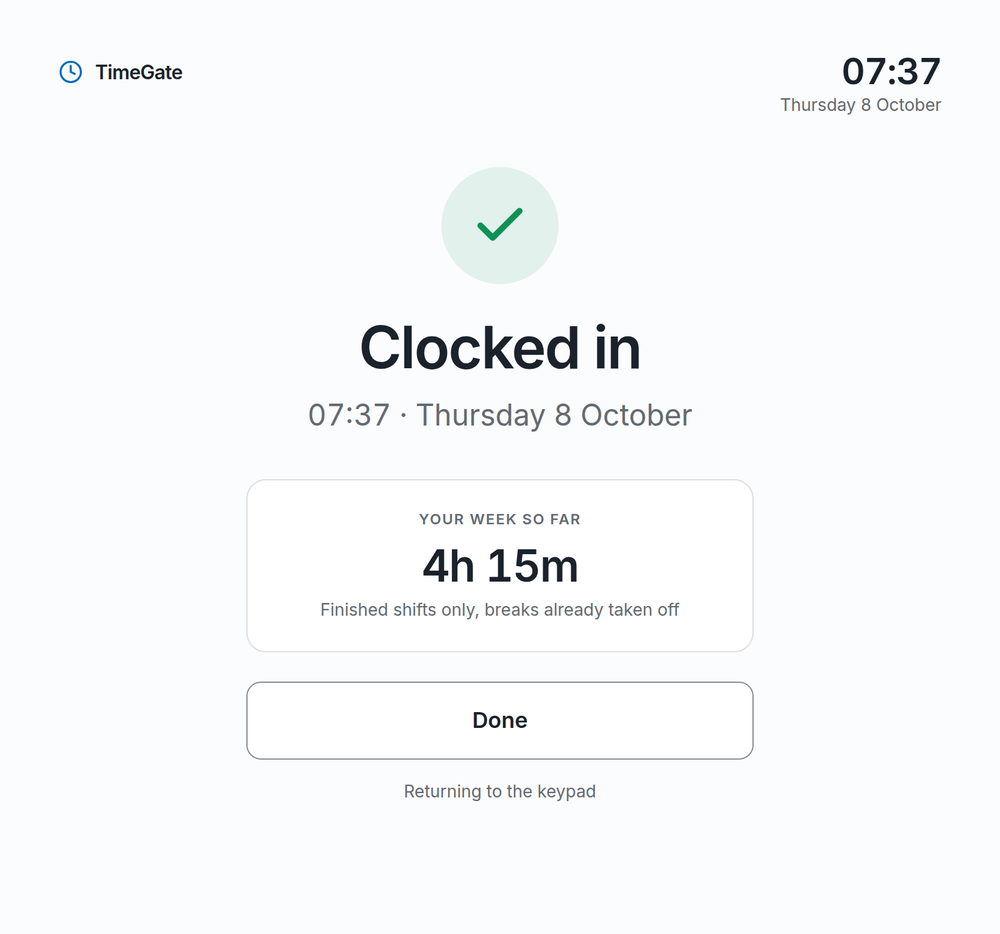
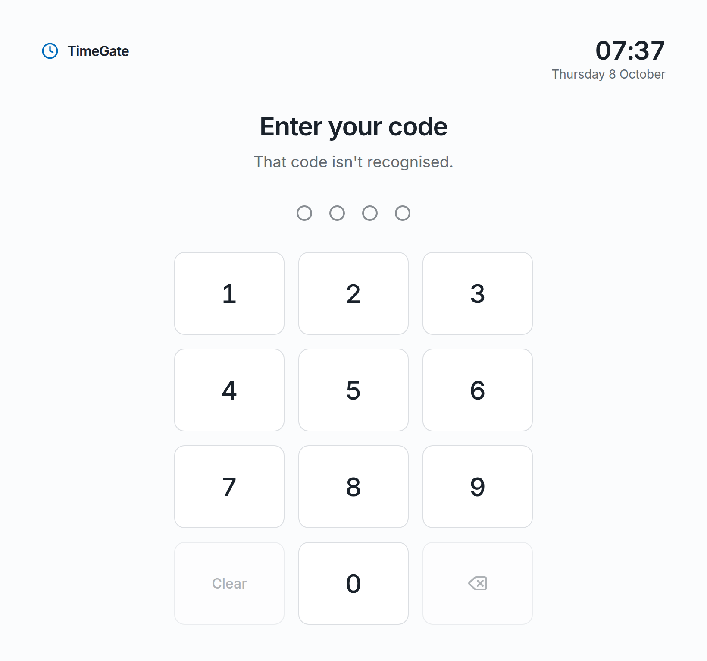
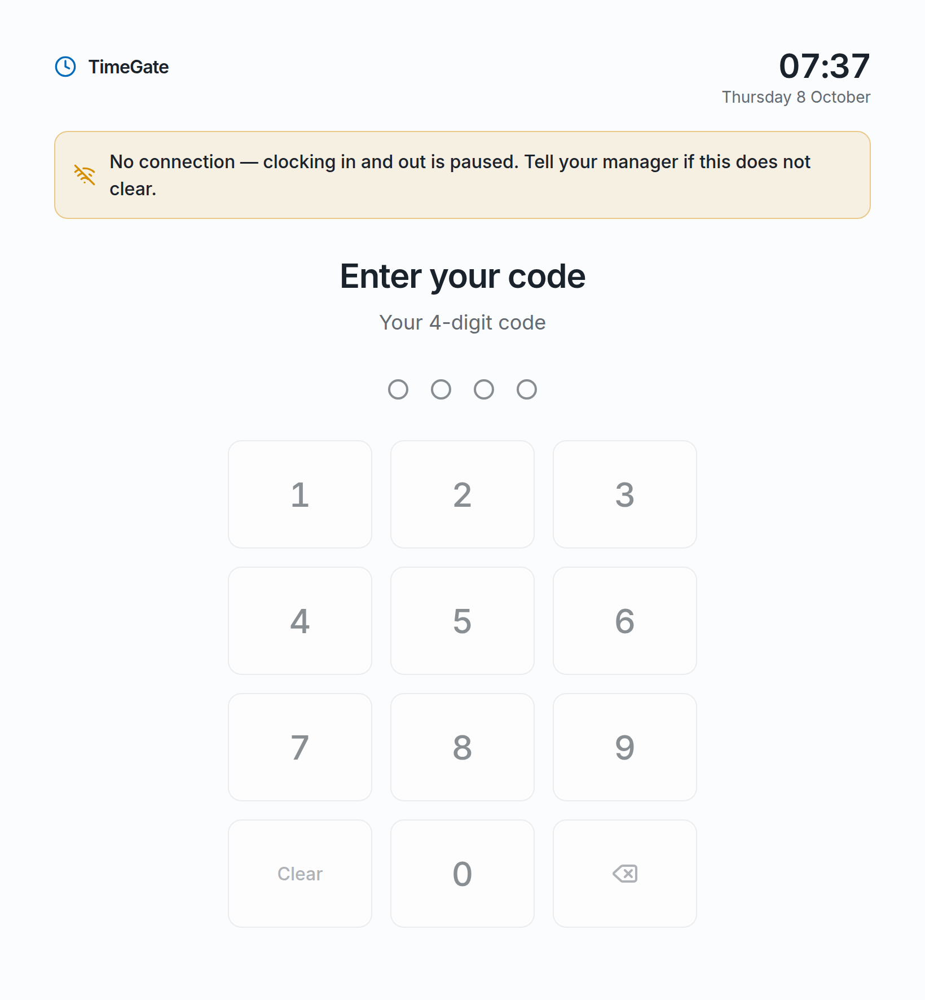
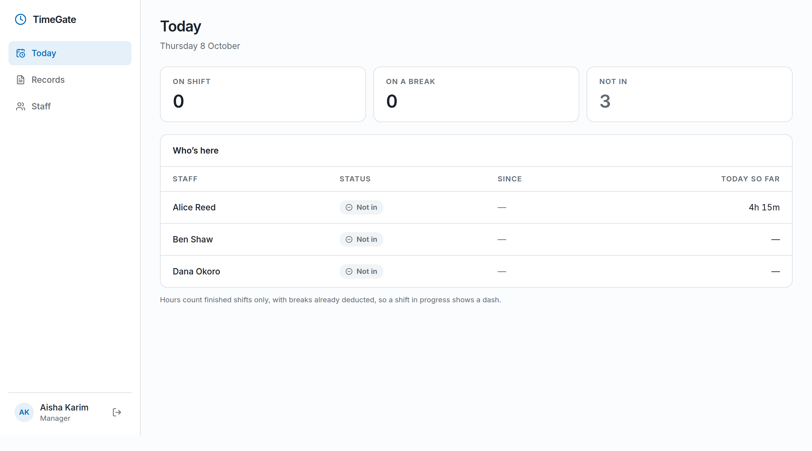
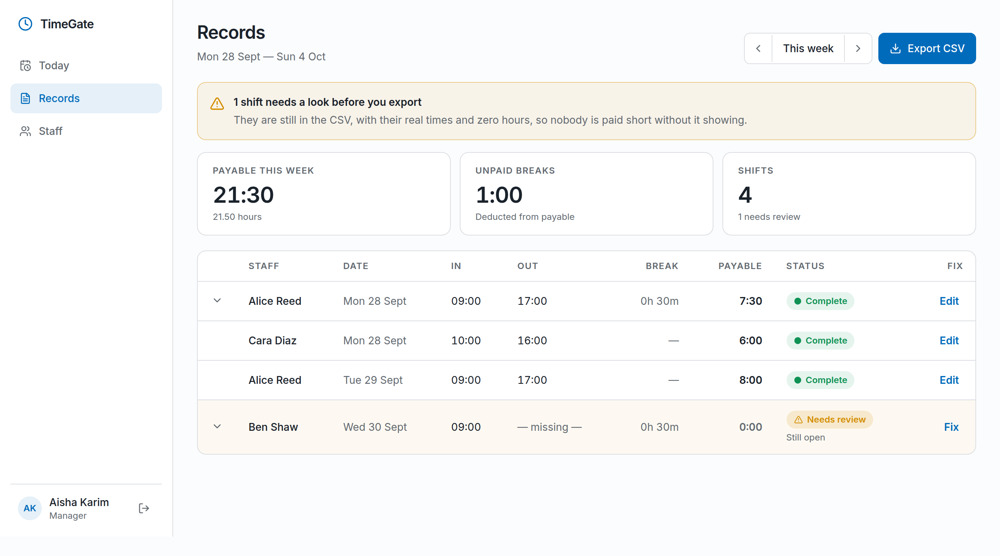
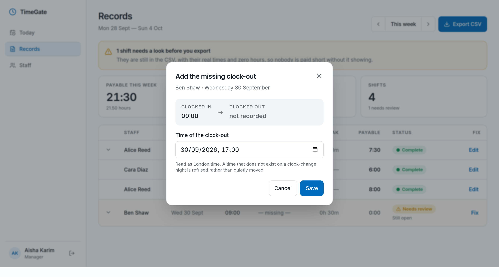
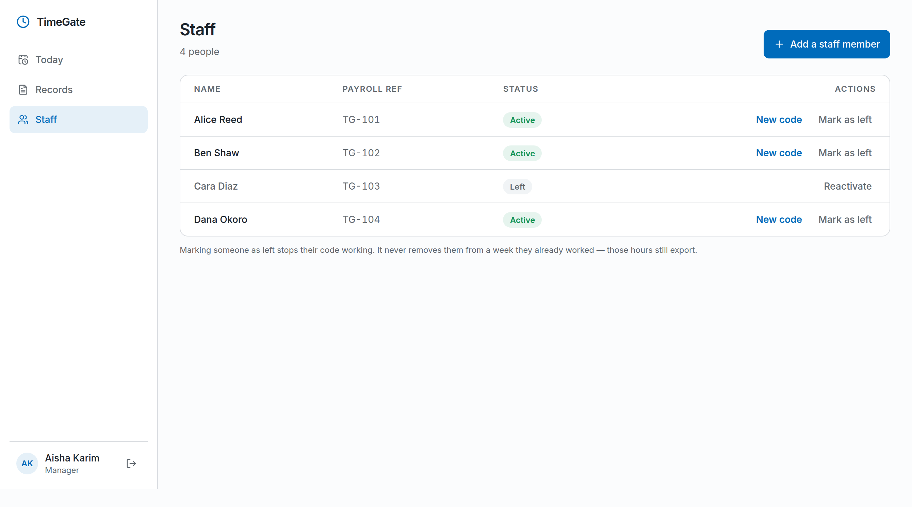
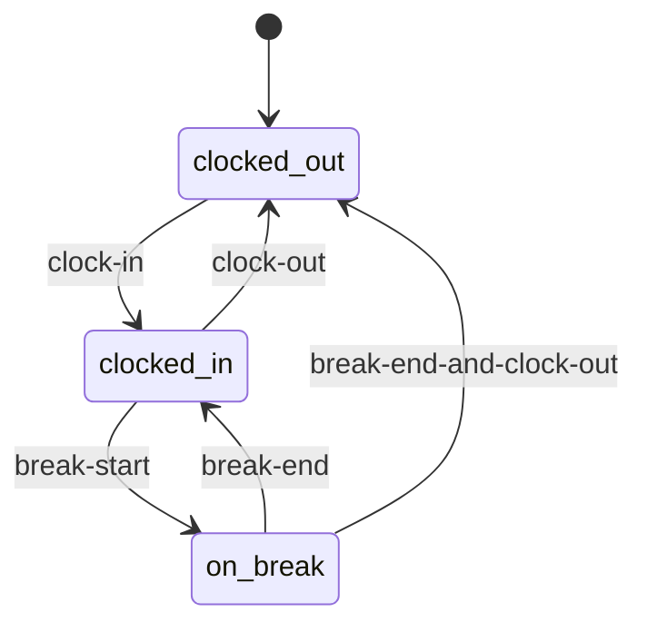

<h1 align="center">TimeGate</h1>

<p align="center">
  <strong>Clock in and out with a 4-digit code, on any device.</strong><br />
  <sub>A punch clock and payroll export for a UK employer of hourly-paid staff — built as a pitch, deployed and working, awaiting the client's decision.</sub>
</p>

<p align="center">
  <a href="https://time-gate.up.railway.app">Live app</a> · <a href="https://time-gate.up.railway.app/api/health">API health</a>
</p>

<p align="center">
  
  
  
  
  
  
  
  
  
  
</p>

<p align="center">
  <strong>Author:</strong> Md. Mahamudul Hasan Pavel ·
  <a href="https://github.com/mahmud035">GitHub</a> ·
  <a href="https://www.linkedin.com/in/mahmud035/">LinkedIn</a> ·
  <a href="https://mahamudulhasan.vercel.app/">Portfolio</a><br />
  <sub><strong>Role:</strong> Sole developer — requirements, design, build and deployment.</sub>
</p>

---

## Table of Contents

- [The problem](#the-problem)
- [Scope & honesty](#scope--honesty)
- [Highlights at a glance](#highlights-at-a-glance)
- [Screenshots](#screenshots)
- [How a day works](#how-a-day-works)
- [Architecture](#architecture)
- [Engineering deep-dives](#engineering-deep-dives)
  - [1. Getting the payroll number right](#1-getting-the-payroll-number-right)
  - [2. A 4-digit code at an open door](#2-a-4-digit-code-at-an-open-door)
  - [3. Installable, without lying about freshness](#3-installable-without-lying-about-freshness)
  - [4. Documentation as a build artifact](#4-documentation-as-a-build-artifact)
- [Key decisions](#key-decisions)
- [Testing](#testing)
- [Tech stack](#tech-stack)
- [Project structure](#project-structure)
- [Getting started](#getting-started)
- [Environment variables](#environment-variables)
- [Scripts](#scripts)
- [API summary](#api-summary)
- [Deployment](#deployment)
- [Trade-offs & what's deferred](#trade-offs--whats-deferred)
- [License](#license)

---

## The problem

A small UK workplace pays its staff by the hour. Hours were tracked on a wall-mounted clock-in device, and the manager asked for something simpler: staff tap in and out, the manager sees who is in, and at the end of the week there is a file payroll can import.

The brief was deliberately small, and the build stayed small to match it. Two goals decide every trade-off in this repository:

1. **The CSV total must be correct.** It becomes somebody's wages. A number that is wrong by an hour is not a cosmetic bug.
2. **Nobody is ever blocked at the door.** A clock that refuses a person at 07:55 because of yesterday's mistake has failed at the only moment that matters.

---

## Scope & honesty

This is a pitch build, and the README describes it as exactly that:

- **Not yet adopted.** It is deployed and working, on free/hobby tiers (Railway + MongoDB Atlas M0) under a personal account. If the employer takes it on, hosting moves to an account they own.
- **No production traffic.** There are no user counts, uptime figures or latency numbers to report, and none are invented here. Everything below is a property of the code that can be checked by reading it or running the tests.
- **No biometrics, no geofencing, no location capture.** Biometrics need hardware there is no budget for. Location tracking has close to no fraud value against a real UK GDPR obligation, so it was cut deliberately, not forgotten.
- **The consequence is stated, not engineered around: staff can clock in from anywhere.** The old device on the wall controlled presence by being a physical object in a physical place; a link on a phone does not. What replaces it is visibility — every punch carries a name and appears on the manager's screen the same day. Whether that is enough is the employer's policy call, and it was put to them as one.

---

## Highlights at a glance

- **Pay arithmetic that survives a clock change.** Durations are UTC millisecond subtraction; only _bucketing_ into days and weeks uses the local timezone. A 22:00–06:00 shift is paid as 7 hours on the spring-forward night and 9 on the autumn-back night — wall-clock maths would underpay the autumn night by an hour, every year.
- **Breaks are unpaid and deducted** — confirmed against how the workplace actually pays, not assumed. 09:00–17:00 with a 15-minute break pays 7h 45m.
- **A flagged shift pays zero, visibly.** A forgotten clock-out is never guessed at. It exports with its real times, zero payable hours and a `needs-review` status, so nobody is paid a number nobody checked — and nobody is silently left out either.
- **One 4-digit code identifies _and_ authenticates, in one indexed read** — an HMAC keyed by a pepper that lives outside the database, behind an unguessable link slug.
- **Wrong codes get slower; the right code never waits.** A per-address tarpit penalises failures only, because a whole workplace shares the tablet's IP and a plain rate limiter would lock everyone out.
- **A stale shift never blocks the door.** Someone who forgot to clock out last night is offered "Clock in" this morning; yesterday's shift is flagged for the manager instead.
- **Installable as a PWA, but the API is never cached.** Offline fails loudly and disables the keypad rather than succeeding against a stale copy.
- **Both printed guides are generated from the real running UI** — seeded demo staff, headless Chrome over the DevTools Protocol, and a run that fails if an expected button is missing.

---

## Screenshots

All screenshots are of the real app, captured by the [guide tool](#4-documentation-as-a-build-artifact) against invented demo staff.

### Clocking in

A 4-digit code on a large keypad, then the person's name and the one or two actions that make sense for their state. After every punch, staff see their week so far — finished shifts only, breaks already taken off.

<table>
  <tr>
    <td width="50%"></td>
    <td width="50%"></td>
  </tr>
  <tr>
    <td align="center"><sub>The keypad</sub></td>
    <td align="center"><sub>Recognised, not yet in</sub></td>
  </tr>
  <tr>
    <td width="50%"></td>
    <td width="50%"></td>
  </tr>
  <tr>
    <td align="center"><sub>Confirmation, with the week so far</sub></td>
    <td align="center"><sub>Working — break or clock out</sub></td>
  </tr>
</table>

### Breaks, mistakes and no connection

On a break the screen offers "End break" and "End break & clock out" — never a bare "Clock out", which would leave an unclosed break for the manager to review. A wrong code says so plainly. With no connection, the keypad is disabled and the screen says why, rather than pretending to record a punch.

<table>
  <tr>
    <td width="33%"></td>
    <td width="33%"></td>
    <td width="33%"></td>
  </tr>
  <tr>
    <td align="center"><sub>On a break</sub></td>
    <td align="center"><sub>Code not recognised</sub></td>
    <td align="center"><sub>Offline</sub></td>
  </tr>
</table>

### The manager's dashboard

**Today** shows who is in, on a break or not in, with hours so far.



**Records** is the payroll week: payable hours, unpaid breaks, and every shift. A shift that needs a look is flagged above the table and pays 0:00 until someone fixes it.



**Fixing a forgotten clock-out** asks only for the missing time, read as London time. A time that does not exist on a clock-change night is refused rather than quietly moved.



**Staff** issues codes, reissues them, and marks people as left. A leaver's code stops working at once; their hours stay in every week they worked.



---

## How a day works

```
clock in  →  start break  →  end break  →  clock out
```

Breaks can be taken as often as needed. The punch screen and the server read from the same state machine, so the UI can never offer an action the server would refuse.



`break-end-and-clock-out` writes two punches at the same millisecond. A database sort on time alone leaves their order undefined — read the wrong way round, a clean shift becomes a review row that pays zero — so every part of the system sorts by time **and then** by the only order a shift can legitimately run in.

---

## Architecture

```
        ┌──────────────────────────────┐      ┌──────────────────────────────┐
        │   ENTRANCE TABLET / PHONE    │      │      MANAGER'S BROWSER       │
        │   /p/<slug>  — punch page    │      │   /login · /dashboard/*      │
        │   installable PWA            │      │   JWT in HTTP-only cookies   │
        └──────────────┬───────────────┘      └──────────────┬───────────────┘
                       │              HTTPS, same origin      │
                       └──────────────────┬───────────────────┘
                                          ▼
                     ┌──────────────────────────────────────────┐
                     │        ONE RAILWAY SERVICE (Node ≥24)     │
                     │                                          │
                     │   Express 5                              │
                     │   ├── /api/*   auth · punch · users ·     │
                     │   │            timesheet  (Zod-validated) │
                     │   └── /*       serves client/dist         │
                     └─────────────────────┬────────────────────┘
                                           ▼
                              ┌─────────────────────────┐
                              │   MongoDB Atlas (M0)     │
                              │   Mongoose 9             │
                              └─────────────────────────┘
```

**One origin, on purpose.** Express serves both the API and the built React client. The browser only ever talks to one origin, so auth cookies are first-party by construction. An earlier design put the client on Vercel and rewrote `/api` to the server; it rested on an untested assumption about `Set-Cookie` surviving an external rewrite. A single origin removes the question rather than answering it. The Vite dev proxy mirrors the same arrangement, so a cookie that works locally works in production for the same reasons.

**Two kinds of user, two kinds of auth.** Managers sign in with email and password and get a short-lived access token plus a rotating refresh token, both in HTTP-only cookies. Staff have no account to sign in to: the code _is_ the credential, entered on a page reached by link.

**Frontend mirrors backend 1:1.** Four backend modules — `auth`, `punch`, `user`, `timesheet` — and four client features with the same names. Each backend module follows the same split (`route → controller → service → model`, with `validation` and `interface`); controllers never touch the database. Pure logic — the punch state machine, the timesheet assembler, the CSV writer — lives in `*.logic.ts` files with no Mongoose import, which is what lets it be tested without a database.

**Shifts are derived, never stored.** The only fact the system records is a punch. A shift is a view assembled from punches at read time, so correcting a punch corrects every total that depends on it, with nothing to keep in sync.

---

## Engineering deep-dives

### 1. Getting the payroll number right

**Challenge.** Everything else in the app is convenience; the weekly total is money. It has to be right across clock changes, across forgotten clock-outs and breaks that never ended, after a manager's correction, and in the spreadsheet the manager actually opens.

**Approach.** Time handling is split into three concerns that are never conflated ([`timesheet.logic.ts`](server/src/app/modules/timesheet/timesheet.logic.ts)):

1. **Duration** is UTC millisecond subtraction — DST-correct by construction.
2. **Bucketing** — which local day, which pay week — is the only step that needs a timezone (`Europe/London` by default), because UTC dates are wrong for about seven months of the year.
3. **Formatting** happens once, at the very end. Rounding happens once, at the end, too.

Shifts are walked out of each person's punches and classified:

| Status         | Meaning                                                  | Pays                              |
| -------------- | -------------------------------------------------------- | --------------------------------- |
| `complete`     | clocked in and out, every break closed                   | worked − breaks                   |
| `open`         | still running right now, within the open-shift limit     | nothing yet                       |
| `needs-review` | `missing-clock-out`, `unclosed-break` or `exceeds-limit` | **0:00** until a manager fixes it |

A shift still running right now is _not_ an anomaly — someone on their tea break has an unclosed break and no clock-out, and both are normal until they come back.

Voided punches are filtered in exactly one function, `countsTowardsWork`, rather than in each caller's query, so "a voided punch does not count" is one rule that a forgotten filter cannot quietly undo. Corrections are manager-only and soft-delete rather than destroy.

The export ([`csv.logic.ts`](server/src/app/modules/timesheet/csv.logic.ts)) is written for a spreadsheet, not a machine: one row per shift so it can be checked by hand; a UTF-8 BOM so Excel does not mangle non-ASCII names; CRLF line endings; and **formula-injection guarding** — any cell starting with `=`, `+`, `-`, `@`, tab or CR is prefixed with `'`, because this file is opened on a manager's work machine.

**Impact.** The total is the sum of exactly what the shift table shows, and a test asserts that the exported total matches the millisecond sum. A shift nobody has checked can only ever pay zero — visibly, with its real times and a status a manager can question.

### 2. A 4-digit code at an open door

**Challenge.** Four digits is ten thousand possibilities — sweepable in seconds by a script that can find the endpoint. But the code has to stay four digits (it is what the workplace already uses), staff must not have to log in, and the tablet at the entrance puts the whole workplace behind one IP address.

**Approach.** Layers, each covering what the one before cannot:

- **An unguessable slug gates the punch endpoints** ([`punchGate.ts`](server/src/app/middlewares/punchGate.ts)). Staff never type it — it arrives in the same link that has to carry their code anyway. It travels in the request body rather than the URL, so it stays out of access logs, browser history and `Referer` headers. A wrong slug returns a plain `404`, indistinguishable from any unknown path, and is compared in constant time.
- **The stored code is an HMAC, not bcrypt** ([`user.code.ts`](server/src/app/modules/user/user.code.ts)). The code must say _who_ this is, and a bcrypt hash cannot be looked up — finding the owner would mean comparing against every employee in turn. An HMAC is one indexed read. bcrypt would not protect the codes anyway: ten thousand candidates fall to offline guessing in about an hour. The HMAC's pepper lives in the environment, not the database, so a database dump alone cannot even compute a candidate. Codes come from the CSPRNG, never sequentially, and are shown exactly once.
- **Wrong codes are slowed, right codes are not** ([`codeTarpit.ts`](server/src/app/middlewares/codeTarpit.ts)). Five free mistakes per address; after that each wrong code waits 400 ms longer, capped at 4 s, over a 10-minute window. The correct code is looked up _before_ any penalty applies and clears the slate. Only after 100 failures from one address does it refuse outright.
- **A global, failures-only backstop** ([`punchThrottle.ts`](server/src/app/middlewares/punchThrottle.ts)) caps wrong codes across all addresses at 300 per 10 minutes, against an attempt spread over many IPs. Successful requests cost nothing, so the same limit is generous to staff and tight to an attacker without needing to tell them apart.

The manager login is separate: account-keyed lockout (never IP-keyed — a forwarded header is attacker-controlled), and a dummy bcrypt comparison when the email is unknown, so a wrong email and a wrong password take the same time.

**Impact.** A four-digit code is not made strong, and the code says so. What changes is that the endpoint cannot be found, sweeping it is slow and conspicuous rather than instant, and none of that is ever felt by a person entering their own code.

### 3. Installable, without lying about freshness

**Challenge.** The entrance tablet should open the punch screen instantly on bad Wi-Fi, and staff should be able to put it on their home screen. But a cached punch response would record a time that has already passed, and a cached timesheet would show hours that are no longer true.

**Approach.** `vite-plugin-pwa` precaches the app shell — JS, CSS, HTML, the Inter font and icons — and **nothing under `/api` is ever cached or served from a cache**: `/api` is excluded from the navigation fallback and routed `NetworkOnly`. When the network goes, the punch screen shows a banner and disables the keypad. The service worker uses `autoUpdate` with `clientsClaim`, because a tablet on the wall never closes its tab — a "new version available, reload?" prompt would mean it never updates.

**Impact.** Fast to open, installable, and updated on every deploy without anyone thinking to clear a cache — while offline stays an honest, visible failure rather than a silent success against stale data.

### 4. Documentation as a build artifact

**Challenge.** The manager and staff need illustrated guides, and screenshots taken by hand drift from the app the moment the UI changes.

**Approach.** [`tools/guide`](tools/guide/README.md) regenerates both PDFs from the running app with `npm run guide`. It seeds invented staff and a week whose arithmetic is easy to follow (relative to the run date, refusing to run against a production config), drives a private headless Chrome directly over the DevTools Protocol — no Puppeteer, no image library, only Node and Chrome — and captures twelve screens through the real UI, including real network emulation for the offline state. A missing button fails the run, because a silent miss once produced a plausible screenshot of the wrong screen. The screenshots in this README come from the same tool:

```bash
GUIDE_SCREENSHOTS_DIR=docs/screenshots npm run guide
```

**Impact.** The guides and this README can be refreshed after any UI change in about a minute, and the tool has already caught bugs that a hand-taken screenshot would not have — a date-dependent seed, a US-formatted date field in a UK app, and a grammar slip on the Records screen.

---

## Key decisions

| Decision                                      | Rationale                                                                                                                                  |
| --------------------------------------------- | ------------------------------------------------------------------------------------------------------------------------------------------ |
| **Breaks are unpaid and deducted**            | Confirmed against how the workplace actually pays. It decides the payroll number directly, so it is not a default to be tweaked.           |
| **A flagged shift pays zero, not a guess**    | Inventing a clock-out time would be inventing payroll data. Zero with a visible status is a number a manager can question.                 |
| **No geofencing or location capture**         | Near-zero fraud value against a real GDPR obligation. The cost — staff can clock in from anywhere — was put to the employer as their call. |
| **No device enrolment**                       | One slug-gated link works on the entrance tablet and on staff phones alike. An earlier per-device token design was dropped for it.         |
| **Code = identity + credential**              | Nothing for staff to remember beyond four digits they already know, and nothing to sign in to.                                             |
| **HMAC with a pepper, not bcrypt**            | Has to be looked up by value; bcrypt over 10,000 candidates protects nothing.                                                              |
| **Penalise failures, never successes**        | A shared tablet means a shared IP. A plain rate limiter would lock out the whole workplace.                                                |
| **Single origin (Express serves the client)** | First-party cookies by construction; removes an untested assumption instead of testing it.                                                 |
| **API never cached by the service worker**    | A stale punch or timesheet is worse than an honest "no connection".                                                                        |
| **Hand-rolled Tailwind, no component kit**    | Radix Dialog for the one primitive that needs accessibility plumbing; everything else is a few small components on oklch tokens.           |

---

## Testing

```bash
npm test     # 62 tests across 4 suites, about half a second
```

The tests cover the logic the payroll number depends on, all of it pure and run without a database:

| Suite                                                                                 | What it pins down                                                                                                                                                     |
| ------------------------------------------------------------------------------------- | --------------------------------------------------------------------------------------------------------------------------------------------------------------------- |
| [`punch.logic.test.ts`](server/src/app/modules/punch/punch.logic.test.ts)             | state derivation, a stale open shift never blocking the door, the actions offered per state, transition and sequence validation                                       |
| [`timesheet.logic.test.ts`](server/src/app/modules/timesheet/timesheet.logic.test.ts) | a normal day, elapsed-time vs wall-clock across DST, local-time week bucketing, shifts that need a human, punch ids carried for corrections, rounding once at the end |
| [`csv.logic.test.ts`](server/src/app/modules/timesheet/csv.logic.test.ts)             | escaping, formula-injection guarding, and the exported total matching the millisecond sum                                                                             |
| [`codeTarpit.test.ts`](server/src/app/middlewares/codeTarpit.test.ts)                 | free attempts, growing delay, cap, hard stop, and a correct code clearing the slate                                                                                   |

The client has no test runner. Its checks are `npm run typecheck` and `npm run lint`, plus the guide tool exercising the real screens end to end.

---

## Tech stack

| Layer            | Technology                              | Version                 | Purpose                                                      |
| ---------------- | --------------------------------------- | ----------------------- | ------------------------------------------------------------ |
| **Runtime**      | Node.js                                 | ≥ 24                    | One process serves API and client                            |
| **Server**       | Express                                 | 5.2.1                   | HTTP, routing, static client                                 |
| **Database**     | MongoDB Atlas + Mongoose                | 9.9.5                   | Punches, users, refresh sessions                             |
| **Validation**   | Zod                                     | 4.6.1                   | Requests (via `validateRequest`) and the environment at boot |
| **Time**         | Luxon                                   | 3.7.2                   | Timezone-aware day/week bucketing                            |
| **Auth**         | jsonwebtoken · bcryptjs · cookie-parser | 9.0.3 · 3.0.3 · 1.4.7   | Manager JWT in HTTP-only cookies                             |
| **Throttling**   | express-rate-limit                      | ^8.7.0                  | Failures-only global backstop                                |
| **Tests**        | Vitest                                  | 5.0.0                   | Pure-logic suites                                            |
| **Client**       | React                                   | 19.3.0                  | UI                                                           |
| **Build**        | Vite + vite-plugin-pwa                  | 8.3.0 · 1.3.0           | Dev server, build, service worker                            |
| **Server state** | TanStack Query                          | 5.102.8                 | All API data                                                 |
| **Forms**        | React Hook Form + Zod                   | 7.87.0 · 4.6.1          | Login, staff and correction forms                            |
| **Routing**      | React Router                            | 8.3.1                   | Punch page, login, dashboard                                 |
| **Styling**      | Tailwind CSS                            | 4.3.3                   | Semantic oklch tokens                                        |
| **UI**           | Radix Dialog · Lucide · Inter           | 1.1.23 · 1.45.0 · 5.3.0 | Dialogs, icons, type                                         |
| **Language**     | TypeScript                              | 6.0.3                   | Both packages                                                |
| **Hosting**      | Railway                                 | —                       | One service, repo root                                       |

---

## Project structure

```
time-gate/
├── client/                         React SPA, built into client/dist
│   ├── public/                     favicon, PWA icons
│   ├── vite.config.ts              dev proxy (same-origin) + PWA config
│   └── src/
│       ├── api/                    axios instance, shared response types
│       ├── components/             layout/DashboardShell · ui/ (Button, CodePad, Dialog, …)
│       ├── features/               auth · punch · timesheet · user   (1:1 with server modules)
│       ├── hooks/                  useOnline
│       ├── pages/                  PunchPage · LoginPage · HomePage · dashboard/{Today,Records,Staff}
│       ├── providers/ routes/      QueryProvider · router + ProtectedRoute
│       └── utils/                  duration and time formatting
├── server/                         Express API
│   └── src/
│       ├── config/                 Zod-validated environment (refuses to boot if invalid)
│       ├── app/
│       │   ├── middlewares/        auth · punchGate · codeTarpit · punchThrottle · validateRequest · …
│       │   └── modules/
│       │       ├── auth/           manager login, refresh rotation, sessions
│       │       ├── punch/          state machine (*.logic.ts) + staff and manager punch paths
│       │       ├── timesheet/      shift assembly, today board, CSV export
│       │       └── user/           staff, codes (HMAC), leavers
│       └── scripts/                seedManager · seedStaff
├── tools/guide/                    generates the PDF guides and these screenshots
├── docs/                           TimeGate-Manager-Guide.pdf · TimeGate-Staff-Guide.pdf · screenshots/
├── HANDOFF.md                      the manager's guide, as markdown
└── package.json                    root scripts orchestrating both packages
```

---

## Getting started

### Prerequisites

- **Node.js ≥ 24**
- A **MongoDB** connection string (Atlas free tier is fine)

### Install and configure

```bash
git clone https://github.com/mahmud035/time-gate.git
cd time-gate

npm --prefix server install
npm --prefix client install

cp server/.env.example server/.env.development   # then fill in the values
```

`NODE_ENV` selects which file is loaded: `.env.development` locally, `.env.production` for a production-mode run on your machine. Both are gitignored.

### Create the first accounts

There is no public sign-up. Seed a manager, and optionally a staff member from the command line (the dashboard can add staff too). Run these from `server/` — the root-level wrappers do not forward flags:

```bash
cd server
npm run seed:manager -- --name "Jane Doe" --email jane@example.com --password "a-long-password"
npm run seed:staff   -- --name "Priya Nair" --payroll-ref TG-002   # prints the code once
```

### Run

```bash
npm run dev:server    # API on http://localhost:5000
npm run dev:client    # client on http://localhost:5173, proxying /api to :5000
```

- Manager dashboard: `http://localhost:5173/login`
- Punch page: `http://localhost:5173/p/<PUNCH_SLUG>`

---

## Environment variables

Validated with Zod at startup — the server exits with a clear message if anything is missing or malformed.

| Variable                 | Required | Default         | Description                                                                                                                                    |
| ------------------------ | -------- | --------------- | ---------------------------------------------------------------------------------------------------------------------------------------------- |
| `NODE_ENV`               | No       | `development`   | Also selects the `.env.<mode>` file                                                                                                            |
| `PORT`                   | No       | `5000`          | **Never set on Railway** — it injects its own                                                                                                  |
| `MONGODB_URI`            | Yes      | —               | Atlas connection string                                                                                                                        |
| `MONGODB_DB`             | Yes      | —               | Database name, e.g. `timegate-dev` / `timegate-prod`                                                                                           |
| `JWT_ACCESS_SECRET`      | Yes      | —               | ≥ 32 characters                                                                                                                                |
| `ACCESS_TOKEN_TTL`       | No       | `15m`           | Format-checked at boot                                                                                                                         |
| `REFRESH_TOKEN_TTL`      | No       | `7d`            | Format-checked at boot                                                                                                                         |
| `BCRYPT_ROUNDS`          | No       | `12`            | 10–15, manager passwords                                                                                                                       |
| `TIMEZONE`               | No       | `Europe/London` | Used for day/week bucketing only                                                                                                               |
| `OPEN_SHIFT_LIMIT_HOURS` | No       | `16`            | Past this, an open shift stops blocking clock-in and is flagged                                                                                |
| `PAY_WEEK_START`         | No       | `monday`        | `monday` or `sunday`                                                                                                                           |
| `PUNCH_SLUG`             | Yes      | —               | ≥ 16 characters; the punch page is `/p/<slug>`. Change it to rotate the link                                                                   |
| `PUNCH_CODE_PEPPER`      | Yes      | —               | ≥ 32 characters; keys the code HMAC. Separate from the JWT secret so rotating one does not break the other. **Changing it orphans every code** |

---

## Scripts

Run from the repository root.

| Script                 | What it does                                                                                            |
| ---------------------- | ------------------------------------------------------------------------------------------------------- |
| `npm run dev:server`   | Server with hot reload (`tsx watch`)                                                                    |
| `npm run dev:client`   | Vite dev server                                                                                         |
| `npm run build`        | Clean-installs and builds client, then server                                                           |
| `npm start`            | Production server from `server/dist`, serving `client/dist`                                             |
| `npm test`             | Server test suites (Vitest)                                                                             |
| `npm run typecheck`    | `tsc --noEmit` in both packages                                                                         |
| `npm run lint`         | ESLint in both packages                                                                                 |
| `npm run seed:manager` | Create a manager account — run inside `server/` to pass flags ([see above](#create-the-first-accounts)) |
| `npm run seed:staff`   | Create a staff member and print their code once — likewise from `server/`                               |
| `npm run guide`        | Regenerate the PDF guides from the running app                                                          |

---

## API summary

Every endpoint returns `{ statusCode, success, message, data }`. All paths are under `/api`.

| Method | Path                | Access      | Purpose                               |
| ------ | ------------------- | ----------- | ------------------------------------- |
| GET    | `/health`           | Public      | Liveness and database connection      |
| POST   | `/auth/login`       | Public      | Manager sign-in                       |
| POST   | `/auth/refresh`     | Cookie      | Rotate the refresh token              |
| POST   | `/auth/logout`      | Cookie      | Revoke the session                    |
| GET    | `/auth/me`          | Manager     | Current user                          |
| POST   | `/punch/lookup`     | Slug + code | Who is this, and what can they do now |
| POST   | `/punch`            | Slug + code | Record a punch                        |
| POST   | `/punch/manager`    | Manager     | Add a missing punch                   |
| PATCH  | `/punch/:id`        | Manager     | Amend a punch's time                  |
| DELETE | `/punch/:id`        | Manager     | Void a punch (soft delete)            |
| GET    | `/users`            | Manager     | List staff                            |
| POST   | `/users`            | Manager     | Add staff (returns the code once)     |
| PATCH  | `/users/:id`        | Manager     | Update, or mark as left               |
| POST   | `/users/:id/code`   | Manager     | Issue a new code                      |
| GET    | `/timesheet/today`  | Manager     | Today board                           |
| GET    | `/timesheet`        | Manager     | Shifts for a date range               |
| GET    | `/timesheet/export` | Manager     | CSV for a date range                  |

---

## Deployment

One Railway service, deployed from this repository:

| Setting            | Value                                                                                                    |
| ------------------ | -------------------------------------------------------------------------------------------------------- |
| **Root directory** | repository root — _not_ `server/`, because Express resolves `client/dist` relative to the server package |
| **Build**          | `npm run build`                                                                                          |
| **Start**          | `npm start`                                                                                              |
| **Healthcheck**    | `/api/health`                                                                                            |
| **Variables**      | set in the Railway dashboard; they override any file                                                     |

Two things that are easy to get wrong:

- **The build installs with `--include=dev`.** Railway sets `NODE_ENV=production`, which otherwise makes npm skip TypeScript and Vite, and the build dies on `tsc: not found`.
- **Never set `PORT`.** Railway injects its own.

Express trusts exactly one proxy hop (Railway's router). Atlas network access is open because Railway's egress IPs are dynamic — acceptable for a pitch, and on the list to revisit before go-live.

---

## Trade-offs & what's deferred

- **Presence is not verified.** A deliberate consequence of no geofencing and no shared device, stated to the employer rather than engineered around. If it matters more than convenience, the link stays on the entrance tablet only.
- **The tarpit is in memory.** It resets on restart and does not span instances. Fine for one process; a shared store would be the step if this ever scaled out.
- **Corrections cover the common case.** Add a missing punch, amend a time, void a punch. There is no audit-history screen yet, though voided punches are kept rather than deleted.
- **English only.** If the workforce is not English-first, a translated staff guide is the most valuable next document.
- **Hosting is a personal free-tier account.** If adopted, it moves to an account the employer owns, and the Atlas network rule tightens.
- **The client has no unit tests.** Its logic is thin by design — pages orchestrate, the server decides — but a component-level suite is the obvious addition if the UI grows.

---

## License

**All rights reserved.** The source is public to read and evaluate. No licence is granted to use, copy, modify or distribute it.

---

<p align="center">
  <sub>Built to get one number right — the one that becomes somebody's wages.</sub>
</p>
